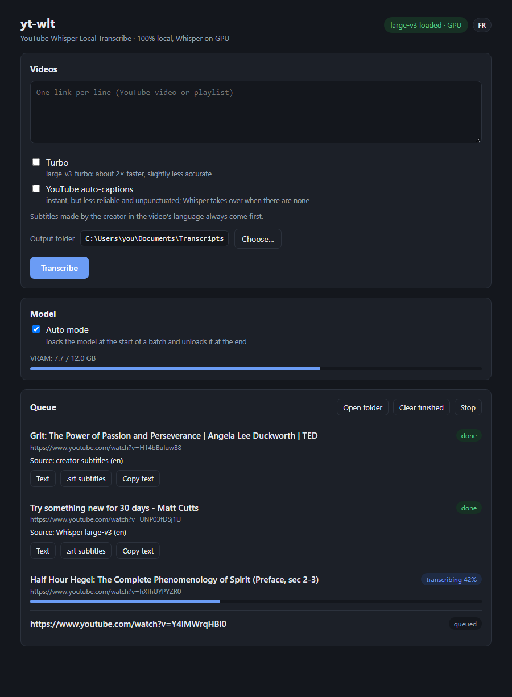

# youtube-whisper-local-transcribe (yt-wlt)

**English** · [Français](README.fr.md)

100% local transcription of YouTube videos from a small web page: paste a list of links, get a `.txt` (paragraphs) and a `.srt` (timestamped) per video.



For each video, in this order:
1. **Creator subtitles** in the spoken language, if any (instant, reliable).
2. **YouTube auto-captions**, only if the box is ticked (instant, but unreliable and unpunctuated).
3. **Whisper**, locally (faster-whisper large-v3 on an NVIDIA GPU): a few minutes per video, punctuated and accurate text.

If Whisper fails, auto-captions are used as a fallback when they exist.

## Installation

| | Windows | Linux |
|---|---|---|
| Install / update | `install.bat` | `./install.sh` |
| Start the interface | `lancer.bat` | `./lancer.sh` |

The installer installs [uv](https://docs.astral.sh/uv/) if missing, creates `.venv` (Python 3.11) and installs faster-whisper, yt-dlp, its JavaScript runtime (deno, bundled) and the CUDA libraries. Neither Node.js nor ffmpeg is required. **Running the installer again updates yt-dlp**: that is the fix when YouTube starts answering with 403 errors.

Without an NVIDIA GPU, Whisper runs on the CPU (slow). The model is downloaded on first use into the Hugging Face cache (~3 GB for large-v3, ~1.6 GB for turbo).

## The interface (http://127.0.0.1:8765)

- **Videos**: one link per line (video or playlist; a playlist is expanded into its videos), or a bare video ID.
- **Turbo**: large-v3-turbo, about 2× faster, slightly less accurate.
- **YouTube auto-captions**: accept them instead of running Whisper.
- **Output folder**: *Choose…* opens the system folder picker; the choice is saved in `settings.json` and applies to videos added afterwards (without a picker, the page asks for the path).
- **Auto mode** (default): the model is loaded at the start of a batch and unloaded at the end. Unticked: *Load* / *Unload* buttons, the model stays in memory between batches.
- **Queue**: per-video progress, source used, *Text* / *.srt subtitles* links, *Copy text*, *Open folder*, *Stop*.
- **Language**: FR / EN button at the top right (browser language by default, choice remembered).

The server only listens on the local machine. Closing the `lancer.bat` window (or Ctrl+C) stops it; starting it again while it runs stops the old instance (including the current job) and starts a fresh one. `kill_instances.bat` does that cleanup alone, without restarting. Other port: `lancer.bat --port 8766`.

Output goes to the chosen folder (`transcripts\` by default): `<title> [<id>].txt` and `.srt`.

## Command line

Whisper only, without queue or subtitles (handy to call from another script):

```bat
transcribe.bat <URL>                 :: writes transcripts\<id>.txt and .srt
transcribe.bat <URL> -l fr           :: force the language (auto-detected otherwise)
transcribe.bat <URL> -m large-v3-turbo
transcribe.bat C:\path\audio.m4a     :: local file
```

## Files

- `core.py`: shared engine (yt-dlp, subtitles, Whisper model, output writing).
- `server.py` + `web/index.html`: web interface (Python standard library, no front-end dependency).
- `transcribe.py`: command line.

## Troubleshooting

- **HTTP 403 on download**: YouTube sometimes refuses a stream at random; the tool retries up to 3 times with a fresh extraction (status "attempt 2/3"). If it fails every time, yt-dlp is outdated → run the installer again.
- **Video dubbed by YouTube** (several audio tracks): the original track is transcribed, and only auto-captions in the spoken language are accepted (not those of the dub).
- **CUDA DLL not found** (`cublas64_12.dll`): the `nvidia-cublas-cu12` / `nvidia-cudnn-cu12` wheels are missing from the venv → run the installer again.
- **Unloading the model** frees most of the VRAM; a few hundred MB (CUDA context) stay in use while the server runs.

## License and credits

Code under the [MIT](LICENSE) license. Built on [faster-whisper](https://github.com/SYSTRAN/faster-whisper) (MIT), OpenAI's [Whisper](https://github.com/openai/whisper) models (MIT) and [yt-dlp](https://github.com/yt-dlp/yt-dlp) (Unlicense), installed by the installer and not redistributed here.

Respect YouTube's terms of service and creators' rights: the transcripts produced are for personal use.
